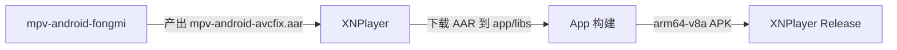

# mpv-android-fongmi

XNPlayer 的 native 内核工厂。

这个仓库不负责做 App 界面，也不直接产出最终 APK。它只做一件事：把经过 AVC PTS 修复的 mpv 内核，编译成 XNPlayer 可以直接使用的 Android AAR。

XNPlayer 主仓库在 [Tom0324/XNPlayer](https://github.com/Tom0324/XNPlayer)。

---

## 30 秒速览

| 项目 | 当前基线 |
|---|---|
| 产物 | `mpv-android-avcfix.aar` |
| 使用方 | XNPlayer |
| 使用路径 | `app/libs/mpv-android-avcfix.aar` |
| ABI | 仅 `arm64-v8a` |
| mpv | `v0.42.0` |
| FFmpeg | `n9.1` (`74e4393595cf2b5857f0da925c4e0dd74ea306e5`) |
| libplacebo | `v7.387.0` |
| AVC HW+ | 已应用 PTS patch |
| OpenList | 不参与本仓库，不打包进 AAR |

一句话：

```text
App 仓库负责“把播放器组装起来”，本仓库负责“提供可靠的播放内核”。
```

---

## 为什么需要这个仓库

XNPlayer 的 AVC 硬解同步修复不在 Java/Kotlin 层，而是在 mpv native 层完成。  
因此必须单独维护一套 native 构建链，确保每次重建 AAR 时：

```text
mpv 版本不漂移
FFmpeg 版本不漂移
libplacebo 版本不漂移
AVC PTS patch 不丢失
mpvEx JNI 接口保持一致
只产出 XNPlayer 需要的 arm64-v8a
```

如果没有这个仓库，App 项目里只有一个 AAR 文件，失去可复现来源。  
一旦 AAR 需要升级或排查 native 崩溃，就无法从头构建。

---

## 仓库之间的关系



职责边界：

```text
本仓库：
  native 依赖 pin
  AVC patch
  JNI 兼容
  AAR 构建
  AAR Release

XNPlayer：
  UI
  汉化
  设置页
  WebDAV
  APK 构建
  最终 Release
```

---

## 当前 AAR Release

Release tag：

```text
native-avcfix-mpv042-ffmpeg9.1-lp7.387.0
```

Release asset：

```text
app-release.aar
```

XNPlayer 中的使用位置：

```text
app/libs/mpv-android-avcfix.aar
```

当前 AAR 已验证包含：

```text
mpv v0.42.0
FFmpeg n9.1
libplacebo v7.387.0
AVC PTS patch
mpvEx JNI event(int, MPVNode)
仅 arm64-v8a native libraries
```

---

## 版本基线

### mpv

```text
v0.42.0
```

选择原因：

```text
官方 latest release
与当前 mpvEx JNI 接口匹配
AVC PTS patch 已在此基线上验证
```

### FFmpeg

```text
n9.1
commit: 74e4393595cf2b5857f0da925c4e0dd74ea306e5
```

选择原因：

```text
官方稳定 tag
不是 dev 分支
不是 rc
```

### libplacebo

```text
v7.387.0
```

选择原因：

```text
官方 latest release
官方 tag 存在
```

历史说明：

```text
v7.399.0 曾作为构建串出现，但不是官方稳定 tag/release。
当前主线不再使用 v7.399.0 作为稳定版目标。
```

### AVC patch

AVC PTS patch 由 workflow 自动应用。  
关键原则：

```text
只要重建 AAR，就必须确认 patch 仍然成功应用。
```

---

## ABI 策略

当前 AAR 只支持：

```text
arm64-v8a
```

不支持：

```text
armeabi-v7a
x86
x86_64
universal
```

原因：

```text
XNPlayer 当前只构建 arm64-v8a。
AVC patch 与 JNI 也只在 arm64-v8a 上完成验证。
```

如果你需要 v7a 或 x86 支持，需要额外完成：

```text
1. 增加对应 ABI 的 native 构建步骤
2. 验证每个 ABI 的 JNI 接口
3. 调整 AAR 打包逻辑
4. 调整 XNPlayer Gradle 配置
5. 重新构建并验证 APK
```

在当前主线中，不要承诺 v7a 或 x86 支持。

详细 ABI 说明见：

```text
docs/AAR_COMPATIBILITY.md
```

---

## 构建入口

主 workflow：

```text
.github/workflows/build_avcfix.yml
```

GitHub Actions 页面显示名称：

```text
Build AVC-fixed mpv AAR (mpvEx JNI)
```

它会：

```text
1. 固定 mpv v0.42.0
2. 应用 AVC PTS patch
3. 固定 FFmpeg n9.1
4. 固定 libplacebo v7.387.0
5. 编译 arm64 native 组件
6. 将 app-release.aar 上传到 GitHub Release asset
```

当前输出方式使用 Release asset，而不是 Actions artifact。  
原因是 Actions artifact 存储空间容易耗尽，Release asset 更适合长期保留构建产物。

---

## 重建前检查清单

每次触发构建前，建议先确认：

```text
mpv pin 是否仍为 v0.42.0
FFmpeg pin 是否仍为 n9.1
libplacebo pin 是否仍为 v7.387.0
AVC patch 步骤是否仍存在
workflow 是否仍只构建 arm64
输出是否为 Release asset app-release.aar
```

构建完成后确认：

```text
AAR 中只有 jni/arm64-v8a/*
libmpv.so 中存在 mpv v0.42.0
存在 AVC patch 构建步骤日志
MPVLib / MPVNode JNI 类存在
event(int, MPVNode) 签名存在
```

---

## 不要删除

以下内容是 XNPlayer 构建链的一部分：

```text
本仓库
Release tag: native-avcfix-mpv042-ffmpeg9.1-lp7.387.0
Release asset: app-release.aar
.github/workflows/build_avcfix.yml
AVC PTS patch 步骤
native 版本 pin
```

删除任何一项都会导致：

```text
AVC AAR 无法复现
XNPlayer 后续无法升级 native 内核
AVC HW+ 修复来源丢失
```

---

## 常见问题

### 为什么不直接把 native 源码放到 XNPlayer？

因为 native 构建链和 App 构建链关注点不同。  
把 native 构建单独放在本仓库，可以避免 App 仓库被大量脚本、依赖和编译缓存污染。

### 为什么不用 Beta3 的现成 so？

Beta3 是成品 APK，不是可复现的 native 构建链。  
它无法保证：

```text
FFmpeg 版本可追踪
libplacebo 版本可追踪
AVC patch 可复现
JNI 与 mpvEx 完全一致
```

### 为什么只看 arm64-v8a？

因为 XNPlayer 当前只构建 arm64-v8a。  
本仓库的目标是稳定支持 XNPlayer，而不是提供通用 mpv-android SDK。

### 这个仓库会打包 OpenList 吗？

不会。

```text
OpenList 使用独立 OpenList-Mobile APK。
播放器通过 WebDAV 连接。
本仓库不产出 OpenList 相关 native 组件。
```

---

## 一句话总结

```text
这里是 XNPlayer 的 native 发动机车间：固定版本、应用 AVC 修复、产出 arm64-v8a AAR。
```
