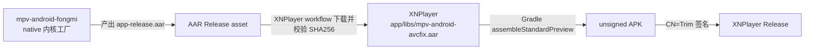

# mpv-android-fongmi

[License](LICENSE) · [AAR Releases](https://github.com/Tom0324/mpv-android-fongmi/releases) · [XNPlayer](https://github.com/Tom0324/XNPlayer)

> XNPlayer 的 native 内核工厂。本仓库不生产 APK，也不负责 App UI；它只负责把可复现的 mpv / FFmpeg / libplacebo 构建链、AVC PTS 修复、ISO 支持和 HW+ 连播修复打包成 XNPlayer 可直接使用的 `arm64-v8a` AAR。

---

## 项目定位

| 项目 | 当前值 |
|---|---|
| 产物 | `mpv-android-avcfix.aar` |
| 唯一消费方 | [Tom0324/XNPlayer](https://github.com/Tom0324/XNPlayer)（私有仓库） |
| 当前主线分支 | `iso-cache-fix-20261127` |
| 当前 AAR Release | [`native-avcfix-mpv042-iso-eof-frame-reset-sync-20261129`](https://github.com/Tom0324/mpv-android-fongmi/releases/tag/native-avcfix-mpv042-iso-eof-frame-reset-sync-20261129) |
| AAR SHA256 | `97174e10559b00cae26480947a5a9b2d5130dc33ad53a5f44e5d263f7c79e51e` |
| ABI | 仅 `arm64-v8a` |
| AVC HW+ | 保留默认 `mediacodec`，并应用 AVC PTS / configure retry / EOF frame reset 修复 |
| OpenList | 不参与本仓库，不打包进 AAR |

一句话：

```text
XNPlayer 负责把播放器组装起来；本仓库负责提供可复现、可验证的 native 播放内核。
```

---

## 构建链关系



职责边界：

| 仓库 | 负责 | 不负责 |
|---|---|---|
| [mpv-android-fongmi](https://github.com/Tom0324/mpv-android-fongmi) | native 依赖 pin、AVC/ISO/HW+ patch、AAR 构建与发布 | App UI、汉化、最终 APK |
| [XNPlayer](https://github.com/Tom0324/XNPlayer) | App UI、设置页、WebDAV、APK 组装与签名发布 | 重建 mpv / FFmpeg native 内核 |

---

## 当前 AAR 能力

当前 Release `native-avcfix-mpv042-iso-eof-frame-reset-sync-20261129` 的 Release Notes 明确包含：

- AVC PTS patch。
- `stream_iso/fongmi`、DVD / Blu-ray / ISO 支持。
- disc demuxer 始终允许预读，修复 ISO 播放缓存过小。
- JNI event 使用非空 `MPVNode`，避免 Java 回调 NPE。
- FFmpeg MediaCodec configure retry：`20 × 100ms`。
- FFmpeg close 诊断：记录 `hw_buffer_count` 与 stop 决策。
- `hwdec_aimagereader.c` uninit 释放顺序修复，保留 NeoPlayer 特性。
- 同步 EOF frame reset：VO frame 引用在解码器 teardown 前释放，参考 mpv PR [#14631](https://github.com/mpv-player/mpv/pull/14631)。
- 保留 NeoPlayer 特性：Vulkan、Dolby Vision GPU mapping、HDR 色彩空间、stale-frame 检查、retained frame、异步 image API、`max_images=5`、AImageReader stats。

> Release tag 中的 `mpv042` 是历史构建命名，不应作为二进制版本字符串的唯一依据。判断当前基线请以 Release Notes、workflow pin 和 AAR 内实际字符串为准。

---

## 构建入口

主 workflow：

```text
.github/workflows/build_iso.yml
```

GitHub Actions 页面名称：

```text
Build ISO-enabled mpv AAR (DVD/Blu-ray)
```

主要步骤：

1. Checkout 本仓库。
2. 准备 JDK 17、autotools、meson、nasm 等构建环境。
3. 从固定来源获取 mpv / FFmpeg / libplacebo 及 DVD/Blu-ray 依赖。
4. 校验 mpv kernel commit 为 `76f963cc4002125776f741738b6c1d8cc08daf18`。
5. 应用 AVC PTS patch，并确认补丁锚点存在。
6. 应用 ISO demuxer、MediaCodec configure retry、close probe、AImageReader uninit、EOF frame reset 等补丁。
7. 校验 NeoPlayer 特性锚点没有丢失。
8. 仅构建 `arm64-v8a`。
9. 校验 `libmpv.so` 中的 ISO / DVD / JNI 标记。
10. 上传 `app-release.aar` 到本仓库 Release asset。

当前发布方式使用 **Release asset**，不是 Actions artifact。Release asset 更适合长期保存；Actions artifact 有过期时间。

---

## 依赖与来源核实

下表只列出本仓库 README 涉及的项目，并标注真实用途。

| 项目 | 链接 | 用途 | 当前状态 |
|---|---|---|---|
| mpv-android-fongmi | [Tom0324/mpv-android-fongmi](https://github.com/Tom0324/mpv-android-fongmi) | native AAR 构建与发布 | 本仓库 |
| XNPlayer | [Tom0324/XNPlayer](https://github.com/Tom0324/XNPlayer) | AAR 消费方 | 当前为私有仓库 |
| mpvEx | [marlboro-advance/mpvEx](https://github.com/marlboro-advance/mpvEx) | App UI / JNI 接口参考 | 上游参考 |
| mpvKt | [abdallahmehiz/mpvKt](https://github.com/abdallahmehiz/mpvKt) | Compose / mpv Android 上游参考 | 历史参考 |
| mpv | [mpv-player/mpv](https://github.com/mpv-player/mpv) | 播放器引擎上游 | 上游参考；EOF reset 参考 PR #14631 |
| mpv-android | [mpv-android/mpv-android](https://github.com/mpv-android/mpv-android) | Android JNI / AAR 工程参考 | 工程参考 |
| FongMi/mpv | [FongMi/mpv](https://github.com/FongMi/mpv) | 当前内核基线 | 使用，固定 commit `76f963cc4` |
| NextPlayerCloud/mpv | [NextPlayerCloud/mpv](https://github.com/NextPlayerCloud/mpv) | workflow 中 `NeoPlayer` ref 来源 | 使用，由 workflow env 指定 |
| FFmpeg | [FFmpeg/FFmpeg](https://github.com/FFmpeg/FFmpeg) | 音视频解码上游 | 上游参考 |
| FongMi/FFmpeg | [FongMi/FFmpeg](https://github.com/FongMi/FFmpeg) | `release-8.1-fongmi` 派生来源 | 使用 |
| NextPlayerCloud/FFmpeg | [NextPlayerCloud/FFmpeg](https://github.com/NextPlayerCloud/FFmpeg) | workflow 中 FFmpeg 镜像来源 | 使用 |
| libplacebo | [haasn/libplacebo](https://github.com/haasn/libplacebo) | 高质量渲染上游 | 上游参考 |
| FongMi/libplacebo | [FongMi/libplacebo](https://github.com/FongMi/libplacebo) | native 构建默认 libplacebo 来源 | 使用 |
| dav1d | [videolan/dav1d](https://github.com/videolan/dav1d) | AV1 解码依赖 | 构建依赖 |
| libass | [libass/libass](https://github.com/libass/libass) | 字幕渲染依赖 | 构建依赖 |

---

## ABI 策略

当前 AAR 只支持：

```text
arm64-v8a
```

不构建：

```text
armeabi-v7a
x86
x86_64
universal
```

原因：

- XNPlayer 当前只构建 `arm64-v8a`。
- AVC patch、JNI 接口和 HW+ 修复只在 `arm64-v8a` 上完成验证。
- 本仓库目标是稳定服务 XNPlayer，不是提供通用 mpv-android SDK。

---

## XNPlayer 如何消费 AAR

XNPlayer 的 workflow 当前会执行：

```bash
curl -fL --retry 3 -o app/libs/mpv-android-avcfix.aar \
  https://github.com/Tom0324/mpv-android-fongmi/releases/download/native-avcfix-mpv042-iso-eof-frame-reset-sync-20261129/app-release.aar
echo "97174e10559b00cae26480947a5a9b2d5130dc33ad53a5f44e5d263f7c79e51e  app/libs/mpv-android-avcfix.aar" | sha256sum -c -
```

也就是说，当前跨仓构建依赖的是：

- 本仓库保持可匿名读取 Release asset；
- AAR SHA256 固定为 `97174e...`；
- XNPlayer 端不依赖本地旧 AAR 文件。

---

## 私有化影响

本仓库如果改成 private：

- **本仓库自己的 AAR 构建不受影响**：workflow 拉取的是公开上游仓库，上传 Release asset 使用本仓库的 `GITHUB_TOKEN`。
- **XNPlayer 当前 workflow 会失败**：它使用无鉴权 `curl` 下载本仓库 Release asset；私有化后匿名请求无法访问，下载会失败。
- **XNPlayer Release 页面不受直接影响**：已经发布的 APK 资产在 XNPlayer 自己的私有仓库内。

若要把本仓库私有化，必须先二选一：

1. **保持本仓库公开**（最简单，现有 workflow 不用改）。
2. **私有化本仓库，并改造 XNPlayer workflow**：
   - 把当前 AAR 提交进 XNPlayer 仓库并改为本地校验；或
   - 为 XNPlayer workflow 配置有读权限的 GitHub token，并改用带鉴权的下载方式。

不要使用第三方 GitHub 加速站访问私有 Release asset，也不要把 token 交给第三方服务。

---

## 重建前检查清单

每次触发构建前确认：

- workflow 仍为 `.github/workflows/build_iso.yml`。
- mpv kernel commit 仍为 `76f963cc4002125776f741738b6c1d8cc08daf18`。
- AVC PTS patch 锚点仍存在。
- MediaCodec configure retry 为 `20 × 100ms`。
- `frame_reset_patch.py` 与 `mediacodec_close_probe.py` 仍存在。
- NeoPlayer 特性锚点校验仍存在。
- ABI 仍只包含 `arm64-v8a`。
- 输出仍为 Release asset `app-release.aar`。

构建完成后确认：

- AAR 中只有 `jni/arm64-v8a/*`。
- `libmpv.so` 包含 ISO / DVD / bluray 标记。
- `force-iso` 与 `stream_iso` 标记存在。
- MPVLib / MPVNode JNI 标记存在。
- `PATCH: hwdec H.264`、`PATCH: vo_eof_reset A`、`PATCH: mediacodec close probe` 等日志存在。
- SHA256 与 XNPlayer workflow 中的固定值一致。

---

## 不要删除

以下内容是 XNPlayer native 构建链的一部分：

```text
本仓库
当前 AAR Release asset: app-release.aar
.github/workflows/build_iso.yml
.github/scripts/frame_reset_patch.py
.github/scripts/mediacodec_close_probe.py
AVC PTS patch 步骤
mpv / FFmpeg / libplacebo pin
NeoPlayer 特性锚点校验
```

删除任何一项都会导致 AAR 不可复现，或导致 XNPlayer 后续无法升级 native 内核。

---

## License

本仓库使用 [MIT License](LICENSE)。第三方依赖与上游项目（mpv、FFmpeg、libplacebo 等）的许可条款以其各自仓库为准。
